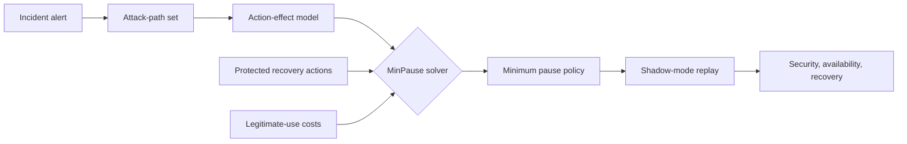
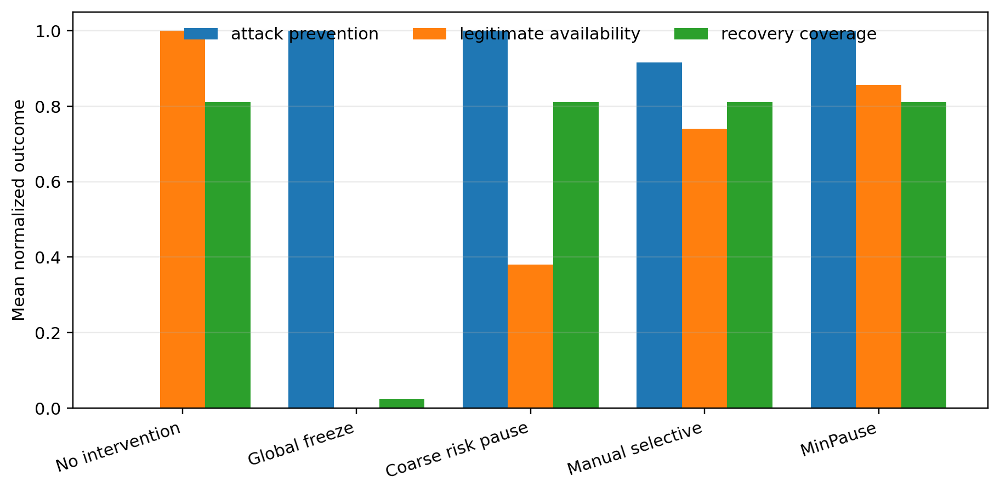
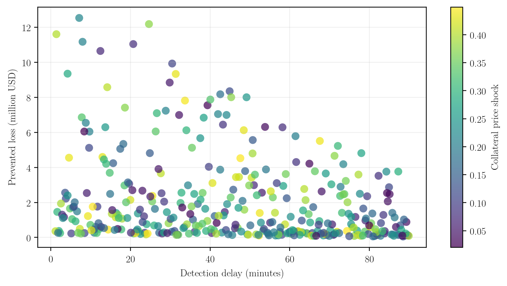

<p align="center">
  
</p>

<p align="center">
  <a href="https://github.com/nikorokni/minpause-recovery-preserving-defi/actions/workflows/ci.yml"></a>
  
  <a href="manuscript/main.pdf"></a>
  
  
</p>

<p align="center">
  <strong>Pause less. Protect more.</strong><br>
  An auditable framework for selecting the minimum-cost emergency pause policy that blocks every supplied DeFi attack path while keeping borrower recovery operations available.
</p>

<p align="center">
  <a href="manuscript/main.pdf"><strong>Read the paper</strong></a> ·
  <a href="docs/MEHRAN_MATH_HANDOFF.md"><strong>Mathematical handoff</strong></a> ·
  <a href="results/scenario_results.csv"><strong>Scenario results</strong></a> ·
  <a href="#reproduce-the-study"><strong>Reproduce</strong></a>
</p>

---

## Why MinPause?

Emergency controls in DeFi are commonly configured by hand. A global freeze is easy to reason about, but it blocks legitimate activity and can prevent borrowers from repaying debt or adding collateral. A narrow manual pause preserves availability, but may leave an alternative loss path executable.

MinPause treats incident response as a constrained weighted hitting-set problem:

> Select the least-cost set of operations that intersects every identified attack path, subject to `repay` and `add_collateral` remaining active.

If an incident cannot be contained without disabling a protected recovery operation, MinPause returns **infeasible** instead of silently weakening the guarantee.

## Research workflow



The detector and attack-path extractor are outside the current scope. MinPause begins once a responder has a candidate family of paths to contain.

## Main results

The deterministic experiment uses **360 Latin-hypercube scenarios** and evaluates five policies per scenario, producing **1,800 policy-scenario runs**.

| Policy | Attack prevention | Legitimate availability | Recovery coverage | Mean policy size |
|---|---:|---:|---:|---:|
| No intervention | 0.0% | 100.0% | 81.2% | 0.00 |
| Global freeze | 100.0% | 0.0% | 2.5% | 9.00 |
| Coarse risk pause | 100.0% | 38.0% | 81.2% | 5.00 |
| Manual selective | 91.7% | 74.0% | 81.2% | 3.00 |
| **MinPause** | **100.0%** | **85.6%** | **81.2%** | **1.34** |

<p align="center">
  
</p>

Recovery coverage is not 100% because keeping a recovery action callable does not mean every borrower has sufficient funds to use it. The model explicitly preserves this distinction.

<details>
<summary><strong>Robustness over detection delay and collateral shocks</strong></summary>

<p align="center">
  
</p>

MinPause covers every supplied path in the generated scenarios, but the economically preventable amount declines as detection is delayed. Policy synthesis therefore complements monitoring; it does not replace it.

</details>

## Mathematical model

For every pausable operation \(f\), let \(x_f=1\) mean “paused.” Each attack path \(P_k\) must be cut:

$$
\sum_{f\in P_k}x_f \ge 1 \qquad \forall P_k\in\mathcal P.
$$

Recovery-critical actions are fixed active:

$$
x_{\mathrm{repay}}=x_{\mathrm{addCollateral}}=0.
$$

The objective minimizes legitimate-use disruption plus group-burden disparity:

$$
\min_x\left(\sum_{f\in F}c_fx_f+\lambda\Delta(x)\right).
$$

The computational method and empirical study are complete. Four formal claims remain deliberately isolated for mathematical verification. The complete statement, notation, assumptions, candidate proof route, and requested output are in the [mathematical handoff](docs/MEHRAN_MATH_HANDOFF.md).

## Repository map

```text
assets/
  minpause-banner.jpg          Repository banner
docs/
  MEHRAN_MATH_HANDOFF.md       Standalone mathematical completion brief
src/minpause/
  model.py                     Operations, paths, users, scenarios, policies
  optimizer.py                 Exact recovery-preserving pause synthesis
  scenarios.py                 Seeded Latin-hypercube experiment design
  simulation.py                Policy counterfactual evaluation
scripts/
  run_experiments.py           Regenerates CSVs, figures, and paper macros
tests/                          15 unit and integration tests
results/                        Scenario-level and aggregate outputs
figures/                        Publication figures in PNG and PDF
manuscript/
  main.tex                      Conference-paper source
  main.pdf                      Compiled paper
  references.bib                Bibliography
```

## Reproduce the study

```bash
git clone https://github.com/nikorokni/minpause-recovery-preserving-defi.git
cd minpause-recovery-preserving-defi

python -m venv .venv
source .venv/bin/activate
python -m pip install -e ".[dev]"

python -m pytest
python scripts/run_experiments.py
```

To rebuild everything, including the PDF:

```bash
bash run_all.sh
```

The full run regenerates the scenario CSV, aggregate summary, both figures, LaTeX result macros, and the manuscript PDF.

## Scope and claims

- Research prototype and **shadow-mode evaluation** only.
- No production, testnet, or mainnet deployment claim.
- Attack paths are supplied to the optimizer; automatic path discovery is future work.
- The policy is only as sound as the supplied operation and attack-path model.
- The code has not been professionally audited and is not financial advice.

## Mathematical completion status

| Item | Status | Required output |
|---|---|---|
| M1 — Attack-path coverage | Pending mathematical review | Correct theorem and proof under an explicit trace abstraction |
| M2 — Feasibility condition | Pending mathematical review | Proof or correction of the proposed iff condition |
| M3 — Finite borrower recovery | Pending mathematical review | Exact resource condition, monotonicity, and reachability proof |
| M4 — Complexity | Pending mathematical review | NP-completeness/NP-hardness reduction from weighted hitting set |

Until these four items are completed, the repository claims empirical path coverage and reproducible simulation results—not completed formal guarantees.

## Citation

Citation metadata will be added after the mathematical section is completed and a submission venue is selected.

